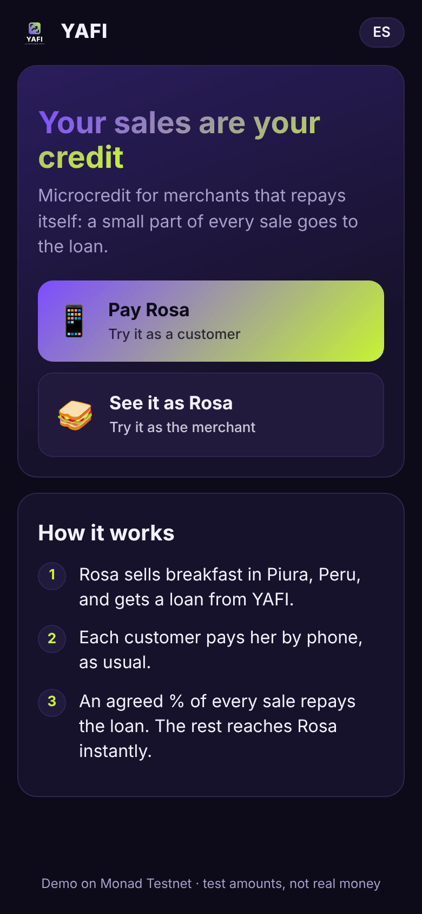
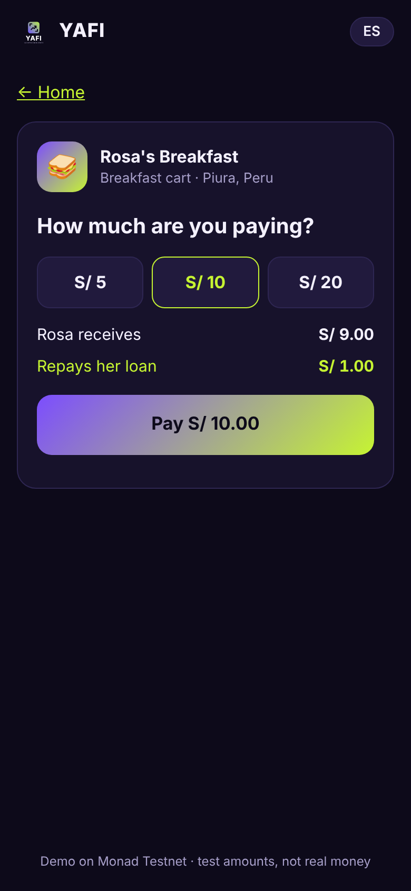
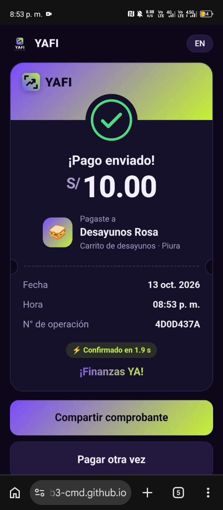
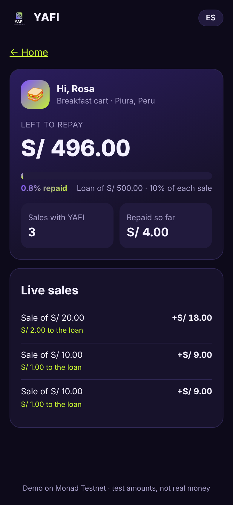
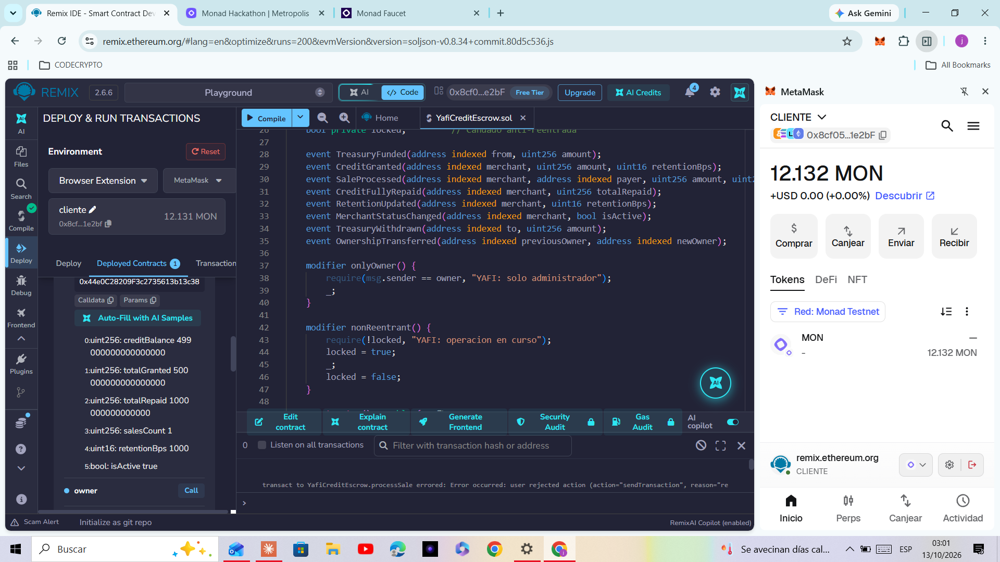

# YAFI · Finance NOW!

**Collect, grow and pay right from your phone.** Your sales are your credit.

> A payments app that never mentions blockchain. Every QR sale an informal merchant receives automatically repays a small microloan on **Monad**, and builds the credit history they never had.

**Track:** Consumer Products & Payments · Monad Metropolis Hackathon 2026
**Live demo:** https://judiweb3-cmd.github.io/yafi/ (Monad Testnet)
**Contract:** [`0x1e8902E1c942F1AF71b2A30548f354D1C9e2c831`](https://testnet.monadexplorer.com/address/0x1e8902E1c942F1AF71b2A30548f354D1C9e2c831) on Monad Testnet (chain ID 10143)

🇪🇸 [Leer en español](README.es.md)

---

## The problem

About **70% of workers in Peru are informal** ([INEI, 2025](https://www.expreso.com.pe/economia/formalizacion-laboral-impulsaria-crecimiento-en-peru-mas-del-70-de-trabajadores-sigue-en-informalidad-epen-inei-noticia/1283864/)). A street vendor like Rosa (an illustrative example, not a real user) sells breakfast from a cart every day, and many customers already pay her by scanning a QR code with a mobile wallet. But she has no payslips and no formal credit history, so banks say no.

When she needs working capital, the option left is often *gota a gota* ("drop by drop"), an informal daily-repayment loan. An IPE study found that about **211,000 Peruvian families** used it in one year, and that **half of informal borrowers pay more than 500% a year** ([IPE via Gestión, 2024](https://gestion.pe/tu-dinero/finanzas-personales/prestamos-gota-a-gota-acechan-a-211000-familias-cuanto-cobran-informalidad-noticia/)).

Rosa does have something lenders want: a steady flow of daily sales. YAFI turns that flow into credit.

## How it works

1. **The lender grants a microloan** (in the demo: S/ 500 at 10% retention per sale, capped at 30%). The money lands in Rosa's wallet immediately.
2. **A customer pays Rosa by QR**, as they already do with mobile wallets.
3. **The smart contract splits each sale in the same transaction:** 90% goes to Rosa instantly and 10% repays her loan. No fixed instalments, no trips to a branch, no cash collection.
4. **Every sale and repayment is recorded on chain.** That behavioural history (sales count, amount repaid, loans fully repaid) is the base for bigger loans later, and for a credit record of the informal economy.

## Risk controls enforced by the contract (v2)

Three rules that microfinance lenders apply by hand are written into `YafiCreditEscrowV2`, so no admin can skip them:

| Rule | What the contract does | Why lenders use it |
|---|---|---|
| **Credit ladder** | The first loan is capped (demo: S/ 500). A new loan is only possible once the current one is fully repaid, and it can be at most 150% of the last one. | Small first loans limit the loss on an unknown borrower; the line grows only with proven repayment. |
| **No self-payment** | A merchant cannot pay their own QR. They can still prepay directly (for example with cash sales) with `repay()`: that lowers the debt and counts as repayment, but not as a sale. | Stops a borrower from cycling their own money to fake a sales history. |
| **Minimum sale** | Sales below a minimum (demo: S/ 1) are rejected. | Stops dust payments from inflating the sales count used as behavioural history. |

The 150% step and the demo limits are illustrative prototype parameters, not figures taken from a regulator. The cap and the minimum are set at deployment and can be changed by the owner with `setLimits`.

The customer never sees a wallet, a seed phrase or the word "blockchain": the app creates an invisible account in the browser and shows prices in soles.

## What we built during the hackathon

Everything in this repository was written during the hackathon window (October 2026). There is no pre-existing code.

| Piece | What it does |
|---|---|
| `contracts/YafiCreditEscrowV2.sol` | Escrow that holds the lending treasury, grants loans, and splits every sale between the merchant and the loan repayment, plus the three risk controls above. Retention is set in basis points with a hard 30% cap, has a reentrancy guard, owner-only lending and custom errors. |
| `contracts/YafiCreditEscrow.sol` | The first version (v1), used for the first on-chain test. Same split logic without the risk controls. |
| `test/` | 45 Hardhat tests: 32 for v2 (the ladder, outstanding loans, self-payment, minimum sale, per-loan progress, the split, never over-collecting, frozen lines, admin controls) and 13 for v1. |
| `app/` | Mobile web app (ES/EN). **Pay Rosa** (customer), **Rosa's view** (live loan balance, sales feed read from contract events, and the size of her next loan) and an **admin panel** (lender, via MetaMask, showing the credit available to Rosa). The app detects whether the contract is v1 or v2. |

### Live on Monad Testnet

- Contract: [`0x1e8902E1c942F1AF71b2A30548f354D1C9e2c831`](https://testnet.monadexplorer.com/address/0x1e8902E1c942F1AF71b2A30548f354D1C9e2c831), deployed with Remix (Solidity 0.8.34) and a 5 MON treasury.
- Demo merchant "Rosa": [`0x44e0C28209F3c2735613b13c3813826A9eeC135D`](https://testnet.monadexplorer.com/address/0x44e0C28209F3c2735613b13c3813826A9eeC135D).
- This first deployment is v1. The v2 contract with the risk controls is tested locally (45 tests passing) and will replace it on Monad Testnet.
- On-chain proof: a 0.5 MON loan (S/ 500 at the demo rate) was granted to Rosa, then a S/ 10 sale left her debt at S/ 499, with 1 sale recorded. All transactions are listed on the contract's explorer page.

## Try it (judges)

1. Open the **live demo** on your phone or computer. The app follows your browser language, and the ES/EN button switches it.
2. Tap **Pay Rosa**, choose an amount and pay. You will see how much goes to Rosa and how much repays her loan, then the confirmation time and a receipt link to the explorer.
3. Open **See it as Rosa** in another tab or phone to watch her balance go down live as sales arrive.

**Test funds.** The invisible account starts empty, and no private key is published in this repo (hackathon rule 5.3). If it has no balance, the app offers two options:
- **For judges and developers → Pay with MetaMask:** pay directly from MetaMask. The app switches to (or adds) Monad Testnet for you (chain ID 10143).
- **Send the activation code:** copy it and open an issue in this repository. The admin sends test funds from the admin panel.

By design, customers and merchants only ever see soles: no wallet, token or network names. The only crypto wording in the app is inside that collapsed judges/developers option and in the lender's admin panel.

## Screenshots

| Home | Pay Rosa | Payment confirmed | Rosa's live view |
|---|---|---|---|
|  |  |  |  |

App screenshots were taken on a local test chain during development. On-chain proof from Monad Testnet (Remix reading the contract after the first sale: debt 0.499 MON, repaid 0.001 MON, 1 sale):



## Why Monad

Repayment per sale means many tiny transactions per merchant, cents at a time. It only works if each payment confirms as fast as the QR payment it replaces and costs almost nothing.

- **Speed:** 300 ms blocks and 600 ms finality ([Monad docs](https://docs.monad.xyz/)). The app shows the real confirmation time after every payment.
- **Full EVM compatibility:** a standard Solidity contract, Hardhat tests, Remix deployment and ethers.js, with no changes.
- **Live UX from events:** Rosa's screen polls `SaleProcessed` logs every few seconds, so a sale appears on her phone almost as soon as the customer pays.

Two Monad specifics shaped the design ([Monad docs: differences from Ethereum](https://docs.monad.xyz/developer-essentials/differences)):
- **Gas is charged on the gas limit, not on gas used.** The app lets ethers estimate the exact limit and keeps a margin in the customer's test balance.
- **Reserve balance (10 MON per account).** A payment whose value would take a normal account below 10 MON reverts, unless the account sent no other transaction in the last 3 blocks. Our customer accounts pay one sale at a time, and the app waits about 2.5 seconds between payments from the same account to stay within that exception.

## Architecture

```
 Customer's phone (browser)                    Monad Testnet
 ┌──────────────────────────┐   processSale()  ┌─────────────────────────────┐
 │ app/  · Pay Rosa          │ ───────────────► │ YafiCreditEscrow            │
 │ invisible wallet (local)  │                  │  • retains X% → treasury    │
 └──────────────────────────┘                  │  • pays net → Rosa (same tx)│
 ┌──────────────────────────┐  SaleProcessed   │  • updates debt, history    │
 │ app/  · Rosa's view       │ ◄─────────────── │                             │
 │ reads balance + events    │   events / view  │ grantCredit() ◄── lender    │
 └──────────────────────────┘                  └─────────────────────────────┘
 ┌──────────────────────────┐  grantCredit() / test funds
 │ app/  · Admin (MetaMask)  │ ─────────────────────────►
 └──────────────────────────┘
```

- **Contract:** holds the treasury, the per-merchant record (`creditBalance`, `currentLoan`, `totalGranted`, `totalRepaid`, `salesCount`, `loansRepaid`, `retentionBps`, `isActive`) and the split logic. `previewSale` shows the split before paying and `creditLimit` shows how much a merchant can borrow now.
- **Frontend:** static HTML, CSS and JavaScript with no build step and no backend. It talks to the public Monad RPC through ethers.js.

## Tech stack

Solidity 0.8.34 · Hardhat 2 (with hardhat-toolbox, Chai and Mocha) · ethers.js 6.17 · vanilla HTML/CSS/JS · Remix IDE + MetaMask (deployment) · GitHub Pages (hosting) · Monad Testnet.

## Run it yourself

Requirements: Node.js 18+ and npm.

```bash
git clone https://github.com/judiweb3-cmd/yafi
cd yafi
npm install
npx hardhat test          # 45 passing
```

**Deploy your own contract (optional).** Either paste `contracts/YafiCreditEscrowV2.sol` into [Remix](https://remix.ethereum.org), compile with 0.8.34 and deploy with MetaMask on Monad Testnet with the constructor arguments `_firstLoanCap = 500000000000000000` (0.5 MON), `_maxLoanCap = 5000000000000000000` (5 MON), `_minSaleAmount = 1000000000000000` (0.001 MON) and `_maxAnnualRateBps = 7500` (75% a year), or use Hardhat:

```bash
cp .env.example .env      # add the PRIVATE_KEY of a testnet-only wallet
INITIAL_TREASURY=1 npm run deploy:testnet          # v2; VERSION=1 deploys v1
```

Then call `grantCredit(merchant, amountInWei, retentionBps, annualRateBps)` from the owner account, for example `grantCredit(<merchant>, 500000000000000000, 1000, 6000)` for 0.5 MON, 10% retention per sale and a 60% simple annual rate (5% a month). The first v1 contract takes `grantCredit(merchant, amountInWei, retentionBps)`.

**Run the app locally.** Set `contract` and `merchant` in `app/config.js`, then serve the folder:

```bash
npx serve app             # or: python3 -m http.server -d app 8080
```

Routes: `#/` home, `#/pagar` pay Rosa, `#/rosa` merchant view, `#/admin` lender panel.

## Contract error messages

v2 uses Solidity custom errors with English names (`SaleBelowMinimum`, `SelfPayment`, `OutstandingLoan`, `AboveCreditLimit`, `NotOwner`, `InsufficientTreasury`, `RetentionOutOfRange`...), and the app turns them into plain messages in Spanish or English.

The v1 contract's comments and error messages are in Spanish, for the target market. The deployed source must match this file exactly for explorer verification, so it is published unchanged. Translations:

| Message | Meaning |
|---|---|
| `YAFI: solo administrador` | Only the admin (lender) |
| `YAFI: operacion en curso` | Operation already in progress (reentrancy guard) |
| `YAFI: monto cero` | Amount is zero |
| `YAFI: comerciante invalido` | Invalid merchant address |
| `YAFI: retencion fuera de rango` | Retention outside 0.01%–30% |
| `YAFI: caja insuficiente` | Treasury has insufficient funds |
| `YAFI: desembolso fallido` | Loan disbursement failed |
| `YAFI: abono al comerciante fallido` | Payment to the merchant failed |
| `YAFI: destino invalido` / `retiro fallido` | Invalid withdrawal address / withdrawal failed |
| `YAFI: nuevo admin invalido` | Invalid new admin address |

## Legal path to launch

Peru has no crypto-specific law, so YAFI is designed to fit rules that already exist:

- **Lending:** YAFI lends its own funds. In Peru, that requires no banking licence, only an anti-money-laundering registration with the SBS, the banking regulator ([Res. SBS 00650-2024](https://busquedas.elperuano.pe/dispositivo/NL/2264383-1)). Rates stay below the legal maximum set by the BCRP, Peru's central bank.
- **Payments:** customers pay through a licensed payment provider, such as card networks or an authorised e-wallet. YAFI never holds the merchants' money ([BCRP Circular 0026-2026](https://busquedas.elperuano.pe/dispositivo/NL/2561268-1)).
- **Blockchain:** Monad is the internal ledger. Users only see soles and never buy, hold or exchange crypto.
- **Pilot:** since 2025, the SBS sandbox also accepts firms the SBS does not supervise ([Res. SBS 04142-2025](https://busquedas.elperuano.pe/dispositivo/NL/2461089-1)). The next step is a supervised pilot there, together with a regulated partner.

## Limitations (honest status)

- This is a **testnet prototype**: test MON stands in for soles at a demo rate of 1 sol = 0.001 MON.
- A single admin sets loans and retention; there is no automated scoring yet.
- The invisible customer account stores its key in the browser's localStorage, which is acceptable for testnet only.
- The contracts have not been audited. An independent code review of v1 found three contract-level limits. v2 fixes two of them: dust and self-paid sales can no longer inflate `salesCount`, and repayment progress is measured per loan. The third remains:
  - A customer can still pay the merchant outside the contract; repayment only happens on sales that go through YAFI.
- The self-payment block stops a merchant from paying from their own account, not from a second account they control. Scoring in production should weigh repaid value and many distinct payers, not only the sales count.
- Monad's reserve-balance rule means a low-balance customer account can only pay if it sent no other transaction in the last 3 blocks, so the app spaces back-to-back payments by about 2.5 seconds.
- YAFI is not a bank and does not take deposits. In Peru, taking deposits from the public requires authorisation from the banking regulator, the SBS (art. 11, Law 26702).
- Before launch, a Peruvian lawyer must validate this design.

## Roadmap

- A risk engine on top of the v2 ladder: rates and line sizes that react to repayment speed and to how sales evolve.
- Independent informal workers paid daily or weekly (not only merchants).
- Partnerships with regulated lenders and municipal savings banks that would use the behavioural history.
- Savings with yield only through a licensed partner.

## Attribution

- [ethers.js](https://github.com/ethers-io/ethers.js) v6.17 (MIT), vendored in `app/vendor/ethers.umd.min.js`.
- [Hardhat](https://hardhat.org) and `@nomicfoundation/hardhat-toolbox` (MIT), for compiling and testing.
- [Remix IDE](https://remix.ethereum.org) and MetaMask, for deployment.
- Market figures come from public sources, linked inline.

## Use of AI tools

As the hackathon rules require, we disclose that this project was built with the help of an AI coding assistant, **Claude (Anthropic)**. It drafted the smart contract, tests, frontend and documentation. The founder defined the product and the credit logic, drawing on 8 years as a microcredit officer for small businesses, reviewed every step, deployed the contract and ran the on-chain tests.

## License

[MIT](LICENSE). The YAFI name and brand are reserved and are not covered by the license.
